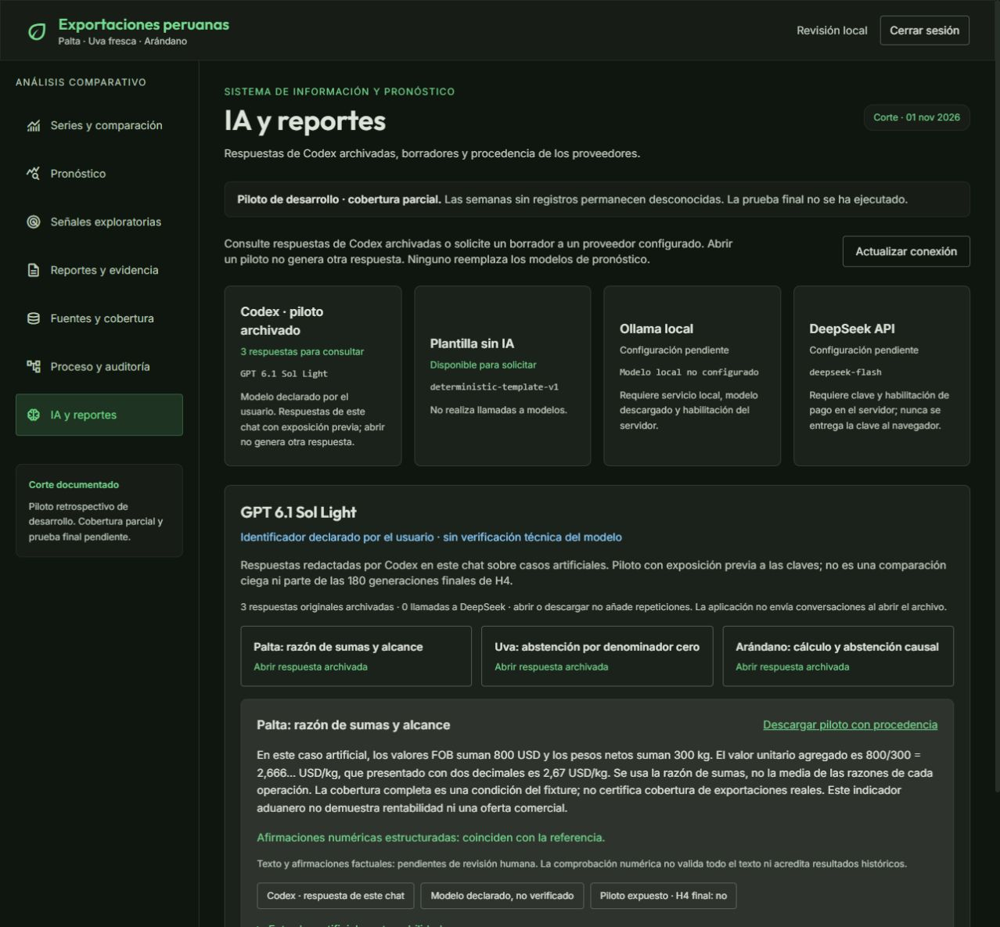

# Verificación UI del piloto Codex

Entorno: preview real FastAPI + Vite en localhost, SQLite QA y cuenta de revisión, proveedores externos deshabilitados. No se usó la base de producción.

Comprobaciones realizadas:

1. Catálogo con tres respuestas y modelo **GPT 6.1 Sol Light** declarado por el usuario, sin verificación técnica.
2. Apertura de palta, uva y arándano; valores, abstenciones y etiquetas de revisión coherentes.
3. Controles diferenciados entre archivo Codex, plantilla y proveedores remotos. Codex no dispone de POST para fingir una nueva generación.
4. Descarga real de arándano y contraste de SHA-256 con el contenido exportado por el backend.
5. Vista de proceso con siete fuentes de evidencia, 24 paquetes y 101.546 registros; distinción explícita respecto al piloto de gráficos.
6. Revisión móvil a 390 × 844 y ausencia de desbordamiento horizontal de página; tamaño de navegador restablecido.
7. Compilación frontend y pruebas backend aprobadas. La sesión QA se renovó tras reiniciar únicamente el preview para cargar las rutas nuevas.

El control de descarga del navegador tardó en entregar el evento; se verificó el archivo finalmente guardado. La prueba de API también comprueba el hash y el permiso de acceso, sin depender de ese evento. No se sostiene que el texto factual haya sido revisado por una persona ni que haya H4 final ejecutada.

Las capturas `codex-palta.png`, `codex-movil.png` y `proceso-actual.png` complementan esta evidencia. Los resultados son técnicos y del piloto expuesto; no acreditan usabilidad con usuarios.
