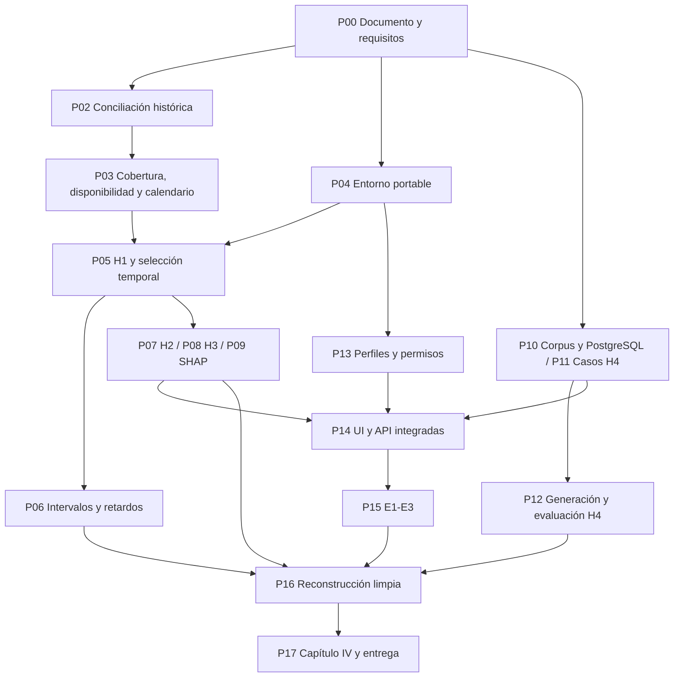

# Plan de desarrollo y verificación sustentado en la tesis

Fecha: **1 de noviembre de 2026**. Base de implementación examinada: `cb23e35836d38cc397639ed66414df16c3a794a9`. Este documento planifica trabajo pendiente; no acredita su ejecución ni modifica la propuesta, el dataset o los modelos.

## 1. Documento rector y alcance

La referencia es [TESIS - COZCO MAURI YOSET](https://docs.google.com/document/d/13cJUk1_AMrI-jsZj0s6a5XuTmE7wXZLFL-SNlPGxt8g/edit), con modificación registrada **2026-10-23T13:27:20.453Z**, cuyos metadatos y texto se consultaron de nuevo. `fundamento-tesis.json` conserva secciones, extractos y procedencia. Los códigos T01–T12 de este plan remiten a ese archivo.

La tesis plantea un sistema de información y pronóstico para palta, uva fresca y arándano, orientado documentalmente a productores y acopiadores. La unidad es producto–destino–semana ISO. Los seis objetivos específicos están en 1.3.2; las reglas de contraste, en 1.4.3–1.4.4. Se desarrollará la solución y se evaluará técnicamente: no entrevistas, encuestas, mediciones de usabilidad o comprensión, decisiones comerciales reales, rentabilidad ni ofertas por lote. H3 es exploratorio y no una hipótesis de superioridad. No se requieren resultados favorables para terminar, pero no se declarará cumplido un objetivo sin evidencia.

**Divergencia que debe resolverse primero:** `docs/02-10-capitulo1.md` conserva H1a–H1e, RMSLE primario para volumen, F1 y evaluación con usuarios. No es el protocolo vigente de Drive. Se preparará una lista de correcciones y se alineará la versión publicable; este plan no reescribe esos capítulos. El plan antiguo de junio tampoco sustituye el documento rector actual.

## 2. Punto de partida y brechas concretas

Se reutilizan la adquisición de 22 paquetes, conciliación y cuarentena, panel conservador de 93.225 registros, sensibilidad heurística, 133 combinaciones y 3.268 celdas observadas. Las 11.415 celdas desconocidas no son ceros. Hay 8.579 filas históricas candidatas nuevas, todavía sin integrar. Se conservan BCRP, SISAP y un punto NASA, sin asumir elegibilidad contextual.

Existen piloto de pronóstico, señales, SHAP, UI, comprobación de 44 archivos, plantillas y adaptadores IA. Pasaron 20 pruebas y la compilación. Eso es evidencia de desarrollo, no de H1–H4 finales ni de una reconstrucción en instalación limpia. Los adaptadores Ollama/DeepSeek se comprobaron con transporte simulado; la plantilla sí se ejecutó de extremo a extremo.

Antes de experimentar deben corregirse estas diferencias específicas:

| Brecha observada en código | Exigencia de la tesis | Trabajo obligatorio |
|---|---|---|
| Referencias naive y mean4 restringidas a celdas inmediatas; media de cuatro semanas consecutivas y sin mediana de 13 | Último valor disponible, cuatro observaciones válidas, mediana de trece y rezago fijo de 52 — 3.5.2 [T04] | Implementar las cuatro referencias as-of y registrar antigüedad, faltantes y fallos; distinguir una característica rolling4 de un baseline de cuatro observaciones válidas |
| Una configuración pequeña por biblioteca | Cuatro configuraciones XGB y cuatro LGB por objetivo — 3.5.3 [T05] | Completar grilla, cortes, selección y desempate; no extrapolar la prueba piloto |
| `np.quantile(..., method='higher')` en intervalos | Orden ceil((n+1)(1−α)), mínimo 40 y no emisión si el orden excede n — 3.5.6 [T06] | Sustituir regla y comprobar límites e indexación; no basta probar 40 errores idénticos |
| Ensemble H3 normalizado con rangos del lote puntuado y K por fecha/objetivo | Percentiles del entrenamiento y presupuesto por producto en universo común — 3.6.3–3.6.4 [T12] | Calibración previa, universo y K conforme al protocolo, sin introducir distribución del lote evaluado |
| Treinta casos obtenidos seleccionando agregados históricos | Diez esquemas de integridad/fallo por cada producto — 3.9.5.1 [T07] | Construir catálogo H4 definitivo; los 30 ejemplos actuales sirven de material inicial, no acreditan ese diseño |
| Tolerancia atómica sin epsilon | Media última unidad decimal más 10⁻⁹ — 3.9.5.1 [T07] | Agregar y probar el margen numérico exacto, sin usar tolerancia relativa |
| Cortes provisionales y objetivos visibles en UI/casos | Declaración de exposición previa y reglas congeladas — 3.5.3 y 3.13 [T05,T09] | Registrar qué fechas, series y salidas se exploraron; ausencia de predicciones del test no significa ausencia de exposición a sus objetivos |

## 3. Correspondencia entre desarrollo y objetivos

| Objetivo | Trabajo pendiente | Evidencia de cierre | Sustento |
|---|---|---|---|
| OE1: identificación y datos | Matriz documental; expansión histórica; estados de observabilidad; cobertura/calidad; disponibilidad y exclusiones | Matriz antecedente–hallazgo–adaptación–prueba y dataset/manifiesto versionados | 1.3.2, 3.3 y Tabla 9 de 3.12.1 [T01,T03,T08] |
| OE2: pronóstico, contexto e incertidumbre | Selección temporal, baselines y grilla exactos, H1/H2, intervalos y L=0/4/8 | Configuración congelada, predicciones OOS, residuos y métricas/denominadores | 1.4.3, 3.5 [T02,T04,T05,T06] |
| OE3: señales | Baseline estacional, percentiles de entrenamiento, K, persistencia e indeterminados | Scores, selección, q/r/u, solapamiento y sensibilidad | 3.6 y análisis H3 [T02,T12] |
| OE4: explicaciones | SHAP de modelos y objetivos finales; escala y trazabilidad | Artefactos explicativos, aditividad y relación con la salida concreta | 1.3.2, 3.7 y 3.12.1 [T01,T08] |
| OE5: reportes | Corpus, recuperación, controles, 30 casos de fallo, 180 salidas y calificación | Claves cerradas, salidas inicial/final, métricas y concordancia | 3.9.5.1 [T07] |
| OE6: integración | Perfiles, consultas con datos, permisos, detalle, persistencia, linaje y E1–E3 | Matriz requisito–función–prueba–evidencia con casos aprobados/parciales/fallidos | 3.3.1, 3.8.5, 3.11–3.13 [T03,T08,T09,T11] |

## 4. Ruta de desarrollo y puertas de verificación

El backlog ejecutable de planificación es `backlog.json`: 18 paquetes P00–P17 con dependencias, responsable, prioridad, esfuerzo estimado, entregable y aceptación. Los esfuerzos son orientativos y no se suman mecánicamente como días de calendario. Los frentes documental, técnico y de revisión humana pueden avanzar con insumos independientes; no se supone disponibilidad de un equipo o revisor externo.

### G0. Congelar el contrato científico — P00/P01

Cerrar fuente rectora, seis objetivos, requisitos derivados y divergencias locales. Registrar acceso previo al bloque propuesto como final. Rotar la credencial antigua por el titular; mantener cuentas y bases QA separadas. No se reclutan usuarios para validar el sistema. Responsable de decisiones científicas: tesista; implementación y evidencia: desarrollo.

**Aceptación:** requisitos trazados a fuente y sección, calendario identificado como provisional, secretos fuera de la entrega y condiciones de ejecución explícitas. La rotación pendiente no impide trabajar con datos públicos, pero impide declarar cerrada esa incidencia.

### G1. Liberar una versión analítica — P02/P03

Conciliar los dos paquetes históricos contra todos los snapshots disponibles y por declaración completa. Conservar originales, variantes, ledger, cuarentena y sensibilidad; no sumar 8.579 filas al panel sin resolver revisiones. Documentar también los enlaces 404, el diccionario ausente y las fuentes no recuperadas.

Para cada celda distinguir: observada con operación; observada sin operación acreditada; faltante/extracción incompleta; aún no observable/no publicada. Solo el segundo estado permite volumen cero; su FOB/kg es no aplicable. La variante de dos estados actual no certifica las otras situaciones.

Cerrar reglas de elegibilidad con historia de entrenamiento, lista de características, series y casos previstos, fechas comunes y corte final. No imponer 104 semanas universales ni seleccionar series por su resultado final. Registrar fechas de periodo, publicación, revisión y extracción, con su evidencia.

**Aceptación:** contabilidad completa, claves únicas en la vista aceptada, fórmula suma FOB / suma peso, exclusiones justificadas, cobertura y observabilidad verificables. Si no hay historia suficiente, recuperar o reformular frecuencia/calendario antes del test; no convertir un faltante en dato mediante IA.

### G2. Poder reconstruir desde cero — P04

Eliminar dependencias duras de D:, fijar intérprete, dependencias directas/transitivas, semillas, CPU/GPU/hilos, rutas relativas y configuración. Establecer comandos separados de adquisición, construcción, desarrollo, evaluación y verificación, con un ejecutor que compruebe precondiciones.

Conservar datos exactos localmente y una forma autorizada de restaurarlos. Repetir una descarga mutable no sustituye el snapshot original. Un colaborador sin acceso a originales privados debe recibir una versión filtrada suficiente o un bloqueo explicado; no se publican DBF con identificación personal.

**Aceptación:** instalación limpia y ejecución desde otra carpeta, comprobación de hashes, ausencia de rutas D: necesarias y fallos explícitos ante artefactos faltantes. Los 20 tests actuales se conservan como regresión, no como prueba de esta instalación limpia.

### G3. Ejecutar H1 e incertidumbre — P05/P06

- Baselines: persistencia del último valor disponible, media de 4 válida, mediana de 13 válida y referencia t+1−52 cuando observable.
- XGBoost: profundidad 3/6 × árboles 200/500. LightGBM: hojas 15/31 × árboles 200/500. Tasa 0,05 y semilla 42; los otros parámetros se fijan y versionan. Cuatro configuraciones por algoritmo y objetivo.
- Cortes por fechas comunes y reajuste semanal. Seleccionar candidato y referencia mediante MAE macro medio de ventanas de desarrollo. Empate absoluto ≤10⁻⁶: menor complejidad y, entre algoritmos, menor tiempo en el mismo entorno.
- MAE macro primario para FOB/kg y volumen. Informar por serie/producto, mejora/deterioro, cobertura y fallos. RMSE, MASE, SMAPE y RMSLE de volumen son complementarios. Truncar predicciones en cero antes de métricas.
- MASE: denominador calculado en entrenamiento con diferencias de rezago52; al menos26 pares observados/publicados y denominador positivo. No calculable queda identificado, sin constante de reemplazo.
- Intervalos 90/95: misma predicción puntual, errores OOS previos de la misma serie, ventana expansiva o últimos 52, mínimo 40; índice ordenado ceil((n+1)(1−α)). Si excede n, no emitir. No mezclar destinos para completar errores. Probar extremos, empates, actualización temporal y exclusión de errores futuros. Caso de regresión: errores ordenados 0…40, n = 41 y nivel 95 % → orden 40 y cuantil 39; detecta una diferencia que los errores idénticos del smoke test no revelan.
- Elegir hiperparámetros en L=0 y mantenerlos en L=4/8. El embargo alcanza información, referencias, etiquetas de ajuste y calibración. El objetivo sigue siendo t+1; la antigüedad de la última observación se informa aparte. No interpretar el backtest como operación en vivo sin fechas de publicación acreditadas.

**Aceptación:** selección cerrada antes de errores del test, casos emparejados y denominadores conocidos; modelo/dataset/run_id vinculados. Si faltan 40 errores no hay bandas fabricadas: se informa la fracción sin intervalo. No se cambiarán mínimos por resultados desfavorables.

### G4. Evaluar contexto, señales y explicaciones — P07/P08/P09

**H2:** mismo algoritmo, parámetros, series, horizonte y folds; solo cambia historial frente a historial+contexto. No optimizar ramas separadamente. BCRP necesita disponibilidad temporal; SISAP, unidad/mercado/publicación; NASA, origen productivo justificable y disponibilidad. Si no se acredita compatibilidad, registrar H2 no evaluable; no suplir con constantes o sintéticos.

**H3:** fijar variables, ventanas, escalamiento, vecinos y evaluación OOS. Los percentiles proceden de entrenamiento previo y la combinación es la media de los tres percentiles con pesos iguales. Definir el universo común por producto; K=max(1,ceil(0,05N)) si N>0, cero selecciones si N=0; desempate por fecha/destino. Corregir el agrupamiento provisional del piloto y conservar población, elegibilidad e indeterminados.

La rúbrica compara w,w+1,w+2 con sus rezagos52: persistencia requiere tres pares con cobertura, referencia positiva, igual signo y cambio relativo ≥ 20 %. Faltantes o referencias inválidas son indeterminados. Excluir las dos últimas semanas sin futuro observable. Informar q/r/u, K=q+r+u, q/(q+r) solo si definido y límites q/K y (q+u)/K, sin llamarlos intervalos de confianza. Sensibilidad 10/20/30 % sobre los mismos casos, sin sustituir señales. No F1/recall/PR-AUC sobre histórico sin etiquetas independientes ni selección de ganador por concordar con la rúbrica.

**SHAP:** usar modelos finales persistidos, lista de atributos y salida/escala identificadas; comprobar reconstrucción aditiva con tolerancia fijada antes de la verificación. Separar transformación logarítmica y truncado. La explicación del pronóstico no explica automáticamente el score de anomalía ni una causa comercial.

**Aceptación:** artefactos reproducibles, ninguna señal usa w+1/w+2 para generarse, cada explicación resuelve su modelo y objetivo y los límites interpretativos aparecen en UI/informe.

### G5. Completar RAG y evaluar H4 — P10/P11/P12

Implementar PostgreSQL/pgvector con migraciones, restauración y pruebas de persistencia; corpus documental con institución, procedencia, fechas, versión, hash y fragmentos. Fijar embeddings multilingües, chunking, top-k, umbrales, filtros temporales y prompt. No recuperar documentos incompatibles por producto, periodo, unidad o nivel comercial.

Rehacer el catálogo como **10 esquemas × 3 productos**: datos completos; cobertura incompleta; nivel comercial incompatible; unidades incompatibles; dato no publicado; versión documental contradictoria; denominador cero; afirmación sin evidencia; petición causal sin respaldo; diferencia entre periodos. Cada caso fija entradas, elementos requeridos, claves numérica/documental y respuestas o abstenciones aceptables **antes** de recuperar/generar. Los casos artificiales se separan del histórico predictivo.

Comparar referencia sin recuperación/verificación con paquete completo; mismos datos y solicitud, generador, versión y parámetros. Tres corridas por caso/configuración:180 salidas. Versionar intentos, guardar salida inicial, corrección controlada, final y plantilla; comprobar también la plantilla. Esta evaluación estima el efecto del paquete, no un efecto exclusivo de RAG. Los borradores ad hoc de la UI no son estas salidas.

Calificar números con media última unidad decimal +10⁻⁹ y texto mediante afirmaciones atómicas contrastadas con clave. Informar por separado errores numérico/factual, cobertura, omisiones, abstenciones y fallos. Denominador cero implica tasa no definida. Resumir corridas dentro de cada caso y después casos con igual peso. H4 solo tiene respaldo descriptivo conjunto si ambas tasas disminuyen y la cobertura cae como máximo5 puntos porcentuales.

Calificación del autor con identificadores aleatorizados que oculten la configuración. Revisión independiente prevista:45 salidas, semilla 42, estratos producto×configuración, siete u ocho por estrato. Si no hay revisor, repetir ciegamente esa muestra tras al menos 7 días; declararla intraevaluador, sin llamarla independiente. Informar acuerdo previo a resolución, kappa si calculable y discrepancias contra clave; si persisten, clasificación conservadora por igual para ambas ramas.

**Aceptación:** catálogo de 30 cumple los diez esquemas por producto,180 salidas identificadas sin contarlas como180 casos independientes, calificación cerrada y métricas recalculables. Un servicio IA no disponible o una clave sin habilitar es prueba no ejecutada, no un resultado negativo del método. Las pruebas reales de pago requieren configuración y autorización de consumo; no se reutiliza la credencial antigua.

### G6. Completar la aplicación y el perfil de usuario — P13/P14

La necesidad central es que un usuario autorizado pueda consultar **datos comunes auditados y versionados**, guardar su análisis y reconstruirlo; no se requiere un dataset empresarial privado por persona.

Roles, permisos y reconstrucción se sustentan directamente en OE6. La biblioteca personal, preferencias e historial son adaptaciones de diseño para atender esa necesidad y la consulta del usuario, no nuevas hipótesis ni exigencias textuales de una investigación con personas.

Mínimo comprometido: autenticación, roles ADMIN/revisor, catálogo de datasets aprobados y versiones autorizadas, consultas propias con producto/destinos/periodo/unidad/corte, historial de borradores y vínculos a ejecuciones. Asociar user_id/query_id/run_id/dataset_version/model_id/report_id y verificar acceso en servidor, no solo en botones. Usar cuentas QA sin recopilar perfiles de productores reales. El rol heredado AUDITOR se describe como revisor técnico, sin prometer autoridad fiscal.

La implementación puede persistir usuarios, permisos, datasets/manifiestos, consultas, ejecuciones, modelos, predicciones, señales, explicaciones, documentos/fragmentos y reportes en tablas relacionadas. El esquema exacto se decide mediante migraciones revisables; no se da por existente por disponer de SQLAlchemy.

UI: comparación → detalle del indicador/pronóstico → señal y SHAP → evidencia/reporte → linaje. Fuente, unidad, periodo, fecha disponible y versión visibles; estados vacío/no calculable/error diferenciados. Los trabajos de importación/entrenamiento deben mostrar estado real (encolado, ejecutando, fallido o terminado), no barras animadas inventadas. Descargas conservan contexto y hashes. Mantener movimiento reducido y navegación por teclado.

Mapear las 28 rutas Flask: migrar lo necesario para requisitos vigentes, retirar o aislar lo que queda fuera de alcance y registrar la decisión. No implementar rentabilidad, inspección comercial o datos por lote solo porque una pantalla histórica los sugiere.

**Aceptación:** dos cuentas prueban accesos permitidos y denegados, restauración de una consulta con el mismo corte y descarga verificable de su informe. La gestión íntegra de sesiones queda identificada; cerrar sesión no se presentará como revocación del JWT mientras no exista esa capacidad.

Mejoras opcionales posteriores: organizaciones multiempresa, datasets privados por usuario y colaboración avanzada. No bloquean los seis objetivos de la propuesta y no deben desplazar el trabajo experimental.

### G7. Pruebas funcionales de la tesis — P15

Ejecutar E1–E3 en la aplicación integrada, no solo en funciones auxiliares:

- **E1:** (200+600)/(100+200)=2,666666… USD/kg; segunda semana 900/300=3; diferencia 0,333333… y variación 12,5 %. Son datos controlados de prueba, no operaciones reales.
- **E2:** peso cero → FOB/kg no aplicable; faltante → advertencia, no cero; FOB agregado y precio en chacra no se comparan como magnitudes equivalentes. Cálculo preciso y redondeo solo en presentación.
- **E3:** emisión 20, última observación 17 y objetivo 21 → horizonte 1 y antigüedad 3; residuo 21 aún inexistente. Recuperar filtros/dataset/modelo/evidencia de su versión y detectar modificación de un artefacto.

**Aceptación:** cada requisito conserva ID, precondición, entrada, pasos, esperado, obtenido, fecha, commit, versión del dataset y captura. No se califica satisfacción, comprensión o tiempo de decisión humana. Los tiempos medidos son de operaciones computacionales.

### G8. Reproducir y cerrar resultados — P16/P17

Reconstruir desde un entorno limpio distinto al directorio de trabajo; conservar snapshot de fuentes, dependencias, configuración, cortes, modelos, predicciones, explicaciones y reportes. Fijar previamente qué hashes deben ser idénticos y tolerancias de resultados numéricos; no ajustarlas al ver diferencias. Recalcular H4 desde las salidas archivadas. Una API remota mutable no garantiza regenerar el mismo texto: registrar modelo/fecha y distinguir regeneración de reproducción de la evaluación.

El capítulo IV y las conclusiones se alimentan solo de ejecuciones identificadas. Mantener separados previsto, ejecutado, aprobado, parcial, fallido, no evaluable y no ejecutado. H1/H2/H4 podrán quedar respaldadas descriptivamente o no; H3 presenta caracterización. Los hashes verifican contenido, no que el test jamás se haya consultado.

**Aceptación:** una matriz final enlaza cada OE con artefactos, ejecución reproducida, limitaciones y resultado. Toda brecha que continúe abierta se declara con alcance; no se rellena con métricas de ejemplo ni con resultados piloto.

## 5. Calendario propuesto y reprogramación

La Tabla 5 de la tesis contiene metas F1 = 15 de octubre, F2 = 22 de octubre y F3 = 27 de octubre Ya pasaron y **no se declararán cumplidas retroactivamente**. La siguiente tabla conserva ventanas de control cercanas a las metas de la tesis; no es una fecha institucional de defensa ni una promesa de cierre con fuentes o recursos no disponibles.

**Capacidad y viabilidad:** el backlog estima **33,5–57 jornadas-persona**, sin sumar como trabajo la espera de 7 días de repetición H4 ni demoras externas. Con una sola persona y cinco jornadas por semana equivale aproximadamente a 7–12 semanas, antes de bloqueos y feriados. Por tanto, no es responsable garantizar el 3 de diciembre con esa capacidad. Llegar a las metas de la tabla exigiría reducir esfuerzo mediante reutilización/automatización comprobada y disponibilidad efectiva de frentes de trabajo; no se da por contratado ni disponible un equipo. El 6 de noviembre se recalcularán capacidad y fecha con tiempos reales, sin recortar controles científicos para conservar el calendario.

| Ventana 2026 | Trabajo y puerta de salida | Condición |
|---|---|---|
| 1–3 noviembre | P00/P01; arrancar entorno P04 y matriz documental | Fuente rectora, incidencias y alcance cerrados |
| 2–6 noviembre | P02/P03; decisión de cobertura el 6 de noviembre | Liberar versión o documentar recuperación/reformulación necesaria |
| 5–10 noviembre | P05/P06/P07; conservar meta F4 del 10 de noviembre solo si G1/G2 se cumplen | No saltar auditoría para respetar una fecha |
| 2–14 noviembre | P10/P11 y P13 por insumos independientes | Corpus, claves H4, perfiles y persistencia preparados |
| 11–17 noviembre | P08/P09; preparación/ejecución inicial H4 | Conservar meta F5 del 17 de noviembre; guía y primera calificación de muestra H4 a más tardar el 17 de noviembre si habrá repetición el 24 |
| Hasta el 21 de noviembre | P14 y verificación del prototipo F7 | Rutas y permisos ejecutables; legado delimitado |
| Hasta el 24 de noviembre | P12 y F6: evaluación H4 | Independiente si disponible; alternativa intraevaluador exige 7 días reales |
| Hasta el 26 de noviembre | P15 y reconstrucción de linaje F8 | E1–E3 ejecutados y fallos registrados |
| 27 noviembre–3 diciembre | P16/P17 y F9 | Reproducción limpia y capítulo IV sustentado |
| 4–10 diciembre | Reserva documentada | Corregir fallos y cerrar anexos, sin inventar resultados |

Si el 6 de noviembre no hay cobertura suficiente, actualizar manifiesto, calendario y alcance **antes** de evaluar errores finales. No escoger un nuevo bloque por conveniencia de sus resultados. La exploración previa de objetivos mediante UI y casos se declarará; un contraste sobre esos datos seguirá siendo retrospectivo/descriptivo y no se presentará como test completamente ciego. Un futuro bloque aún no observado requerirá otro corte y disponibilidad real, sin promesa de ejecución dentro de estas fechas.

## 6. Definición de terminado y orden inmediato

La idea estará desarrollada cuando exista trazabilidad desde requisitos y fuentes hasta consultas, modelos, explicaciones y reportes, con pruebas y reconstrucción limpia; cuando los seis objetivos tengan un resultado técnico documentado, y cuando el estado de H1/H2/H4 y la caracterización H3 provengan de sus protocolos, no de la apariencia de la UI.

**Orden inmediato:** P00/P01 → P02/P03 y P04 → P05/P06; abrir P10/P11 y P13 sin esperar resultados de H1. Después P07–P09 y P12/P14 → P15/P16 → P17. La prioridad es cerrar datos y contrato experimental, no añadir pantallas ajenas a los objetivos.

## 7. Archivos y control del plan

- `backlog.json`: paquetes, dependencias, esfuerzo orientativo, responsable, aceptación y estado inicial.
- `fundamento-tesis.json`: fuente rectora, fecha de modificación, secciones y extractos de sustento.
- `verificacion-plan.json`: comprobación de referencias, cobertura de OE1–OE6 y ausencia de ciclos.
- `hashes.json`: huellas de esta versión del plan, salvo el propio listado.

Actualizar estado solo con un enlace a ejecución/evidencia. Un bloqueo externo debe registrarse por causa y fecha; una decisión metodológica modificada debe conservar versión anterior, motivo y resultados conocidos. La creación de este plan no ejecuta ninguna de sus fases pendientes.
